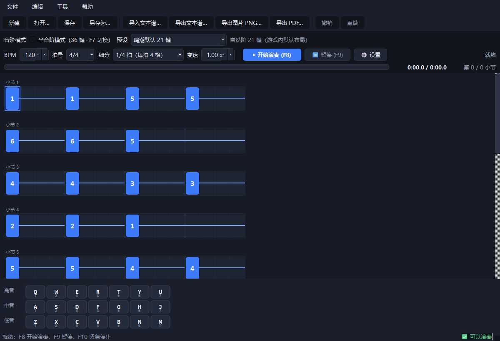
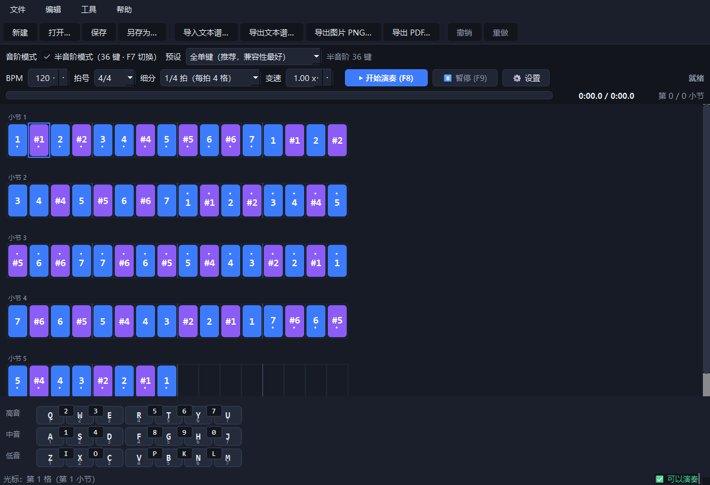
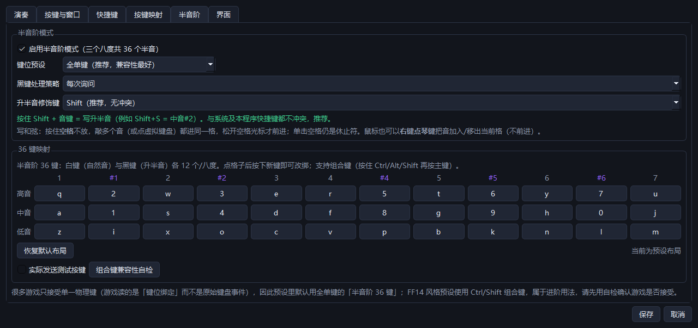
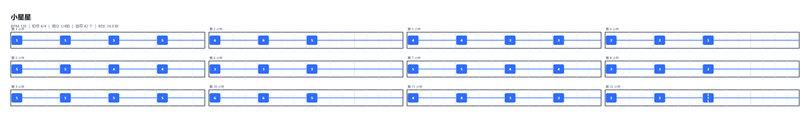

# 鸣潮自动演奏器（wuwa-autoplay）

**中文** ｜ [English](README_EN.md)

<!-- 徽标在第一次 CI 跑完后就会亮 -->
[](https://github.com/dream1angel/wuwa-autoplay/actions/workflows/tests.yml)
[](LICENSE)
[](https://www.python.org/)
[](#2-安装)

把你在界面上编排的曲谱，按**严格节拍**转换成模拟键盘按键，在《鸣潮》的乐器玩法里自动弹奏出音乐。

* 平台：Windows 10 / 11
* 技术栈：Python 3.10+ ／ PySide6（Qt）／ pydirectinput（SendInput + 扫描码）／ keyboard（全局热键）
* 计时精度：**实测单事件误差 p99 ≈ 0.02ms、平均 ≈ 0.01ms**（目标 < 5ms，见 `tests/test_engine.py`）
* 核心逻辑与界面完全解耦：演奏引擎可脱离 GUI 单独跑基准测试
* **两种音阶模式**：
  - **自然阶模式（默认，21 键）**：三个八度 × 7 个自然音，与游戏内布局一致；
  - **半音阶模式（可选，36 键）**：三个八度 × 12 个半音，**默认关闭**，按 **F7** 或勾选运输条开关开启；
    36 键映射可自由改绑（支持组合键），内置「全单键」与「FF14 风格」两套预设。

> 📌 v2 提示词（`PROMPT.md`）里的半音阶模式**已实现**，实施状态见该文档末尾的表格。

> ⚠️ **免责声明：仅供个人学习、练习与娱乐使用。** 请自行确认并遵守《鸣潮》的用户协议；
> 本工具通过模拟键盘输入实现，与游戏官方无任何关联，使用可能带来的账号风险由使用者自行承担。
> 作者不对任何后果负责（见 [许可证](#16-许可证)）。

> 🤖 **开发声明：本项目由作者与 DSH 协作完成。**
> [DSH](https://github.com/deepseek-ai/deepseek-harness)（DeepSeek Harness，AI 编码代理，npm 包 `@deepseek-ai/dsh`）
> 参与了架构设计、代码实现、测试编写与打包验证；需求、取舍与最终验收由作者负责。
> 详见 [致谢](#15-致谢与开发声明)。

---

## 1. 界面速览

```
┌──────────────────────────────────────────────────────────────────────┐
│ 新建 打开 保存 另存为 │ 导入文本谱 导出文本/PNG/PDF │ 撤销 重做        │
├──────────────────────────────────────────────────────────────────────┤
│ BPM[120] 拍号[4/4] 细分[1/4拍] 变速[1.00x]  ▶开始(F8)  ⏸暂停(F9) ⚙设置 │
├──────────────────────────────────────────────────────────────────────┤
│ 音阶模式 ☐半音阶模式(F7)  预设[全单键（推荐）▾]   自然阶 21 键        │
├──────────────────────────────────────────────────────────────────────┤
│  小节1                    │  小节2                                   │  ← 节拍网格
│  [1̇][#1][2̇][3̇] │ [4][5][6][-] │ [1] . . . │ [7̣][1][2] . .              │  ← 上点=高音 下点=低音
├──────────────────────────────────────────────────────────────────────┤
│  高音  Q 2 W 3 E R 5 T 6 Y 7 U                                       │  ← 虚拟键盘
│  中音  A 1 S 4 D F 8 G 9 H 0 J      （半音阶模式：3×12，黑键更窄更深）│
│  低音  Z I X O C V P B H N K J L M                                   │
├──────────────────────────────────────────────────────────────────────┤
│  ████████░░░░░░░░  0:12.4 / 0:24.0      第 4 / 12 小节     演奏中      │
└──────────────────────────────────────────────────────────────────────┘
```



上面是实际界面（自然阶模式载入《小星星》），更多截图见 [§14](#14-截图)。

一个格子 = 一个最小细分单位。格子里可以叠多个音（**和弦**，纵向显示），
时值大于 1 格的音用横线连过去（**延音**），被延音占用的格子会变暗。
半音阶模式下虚拟键盘变成 **3 行 × 12 键**（黑键是更窄更深的琴键）。

**格内符号（两种模式完全统一）**：用简谱「数字 + 上下八度点」表示音高，
**与你在游戏里按哪个键无关**（键位看下方虚拟键盘或设置页）：

| 写法 | 含义 |
|---|---|
| `1` `2` … `7` | **中音**区（数字不加点） |
| `1` 带**上点** | **高音**区（简谱高八度记号） |
| `1` 带**下点** | **低音**区 |
| `#1` `#4` | 升半音（黑键，格子底色为紫色） |

> 方框里画不出点，上面的示意图用 `1̇` 表示上点。导出 PNG/PDF 用的是同一套符号。

---

## 2. 安装

### 方式 A：下载打包好的 exe（不想装 Python 就用这个）

到 [Releases](https://github.com/dream1angel/wuwa-autoplay/releases) 下载 `wuwa-autoplay.exe`，
双击运行，Windows 会弹 UAC 提权确认（向游戏发送输入需要管理员权限）。

### 方式 B：从源码运行

```powershell
# 1) 确认 Python 版本（3.10 以上，推荐 3.11~3.13）
python --version

# 2) 取代码 + 装依赖
git clone https://github.com/dream1angel/wuwa-autoplay.git
cd wuwa-autoplay
python -m pip install -r requirements.txt

# 3) 启动
python main.py
```

依赖说明：

| 包 | 用途 | 必需 |
|---|---|---|
| PySide6 | 图形界面 | ✅ |
| pydirectinput | 发送按键（SendInput + 扫描码，兼容 DirectInput 游戏） | ✅ |
| keyboard | 全局热键（F8/F9/F10） | ✅ |
| pyinstaller | 打包 exe | 仅打包需要 |
| interception | 内核级按键后端（需另装驱动并重启） | 可选 |

**管理员权限**：Windows 下向游戏窗口发送输入通常需要提权。程序启动时会检测，
并询问是否以管理员身份重启；也可以直接右键 `main.py` / exe →「以管理员身份运行」。

---

## 3. 五步上手

1. **写谱**：用键盘敲 `q w e r t y u`（高音）、`a s d f g h j`（中音）、`z x c v b n m`（低音），
   每敲一个音光标自动右移一格；也可以直接点下方虚拟键盘。
2. **调拍子**：设置 BPM（40~300）、拍号、最小细分（1/4、1/8、1/16、1/32 拍）。
3. **试一下**：设置里把「按键后端」临时换成「演练模式（不发送按键）」，点开始，看进度条与节拍对不对。
4. **正式开始**：切回真实后端 → 点「▶ 开始演奏(F8)」→ 倒计时 3 秒内切到游戏 → 程序自动最小化并开始按键。
5. **应急**：任何时候按 **F10** 立即松开所有按键；**F9** 暂停/继续；演奏中 **Esc** 退出演奏。

---

## 4. 操作手册

### 4.1 编辑快捷键

| 按键 | 作用 |
|---|---|
| `q w e r t y u` | 高音 1~7 |
| `a s d f g h j` | 中音 1~7 |
| `z x c v b n m` | 低音 1~7 |
| `1`~`7` | 中音数字谱快速输入 |
| **按住 `空格` + 敲多个音** | **写和弦**：这一串音全部进同一格，松开空格光标才前进 |
| `空格`（单击） | 休止符（清空当前格并前进） |
| **右键点虚拟键盘** | 把该音加入 / 移出当前格（不前进，点着写和弦） |
| `Backspace` | 退一格并清空 |
| `Delete` | 清空当前格 / 删除选区 |
| `← →` | 左右移动光标（选中框）；**有选区时整体平移选中框** |
| `↑ ↓` | 上下移动一整行（一行 = 当前宽度下的一排小节）；有选区时整体平移 |
| `Shift + 方向键` | 扩展 / 收缩选区（以锚点为准） |
| `Esc` | 取消选区（之后方向键恢复为移动光标） |
| 鼠标拖动 | 框选一段乐句 |
| 双击格子 | 选中该音的完整时值范围 |
| `[` / `-` | 时值缩短 1 格 |
| `]` / `=` | 时值延长 1 格（延音） |
| `Ctrl+C / X / V` | 复制 / 剪切 / 粘贴（合并到目标格） |
| `Ctrl+Shift+V` | 粘贴（覆盖目标区间） |
| `Ctrl+D` | 把当前选区复制到其后 |
| `Ctrl+Z / Ctrl+Y` | 撤销 / 重做（上限见设置，默认 200 步；**整段和弦手势算一步**） |
| `Ctrl+A` | 全选 |
| `Ctrl+Up / Ctrl+Down` | 选区升 / 降八度 |
| `Ctrl+Left / Ctrl+Right` | 选区降 / 升一度 |
| `Ctrl+R` | 检查音域（越界音会被标红） |

**半音阶模式专属**（开启后可用）：

| 按键 | 作用 |
|---|---|
| **按住修饰键 + 音键** | 写升半音，默认 `Shift`（`Shift+S` = 中音#2、`Shift+F` = 中音#4）；修饰键可在设置里换成 Ctrl / Alt / 不设 |
| `#` 然后按音键 | 升半音的另一种输入方式（把修饰键设为「不设」时使用） |
| `Ctrl+Shift+Left / Right` | 选区降 / 升半音 |
| `Ctrl+Shift+Down / Up` | 选区降 / 升八度（±12 半音） |

> 为什么默认用 `Shift` 而不是 `Ctrl`：`Ctrl+字母` 被本程序自身的快捷键占满了
> （`Ctrl+S` 保存、`Ctrl+Z/Y` 撤销重做、`Ctrl+C/V/X` 复制粘贴、`Ctrl+A` 全选、
> `Ctrl+D` 复制乐句、`Ctrl+R` 音域检查、`Ctrl+N/O/Q` 新建/打开/退出、`Ctrl+,` 设置），
> Qt 的快捷键会在按键处理之前把它们截走，写谱就会失灵；
> `Shift+字母` 在系统和本程序里都没有别的含义，而且 **Shift 本身就是升号的记谱习惯**。

### 4.2 演奏快捷键（可在设置页自定义）

| 默认键 | 作用 | 注册时机 |
|---|---|---|
| **`F7`** | **切换半音阶模式（开 / 关）** | 程序启动即注册；演奏进行中禁止切换 |
| `F8` | 开始 / 停止演奏 | 程序启动即注册 |
| `F9` | 暂停 / 继续 | 程序启动即注册 |
| `F10` | 紧急停止（立即释放所有按键，含修饰键） | 程序启动即注册 |
| `Esc` | 退出演奏模式 | **仅演奏期间**注册，平时不抢占 Esc |

### 4.3 设置页

* **演奏**：按下-抬起间隔（默认 30ms）、和弦/组合键错开（默认 1.5ms）、
  最小按键间隔（默认 25ms，用于绕开游戏连击节流）、开始倒计时（默认 3 秒）。
* **按键与窗口**：按键后端选择与可用性检测；目标窗口关键字（默认
  `Wuthering Waves|鸣潮|Client-Win64-Shipping`，任一命中即算在游戏里，也可一键读取当前前台窗口的进程名）；
  失焦自动暂停开关。
  > 焦点守护采用「先看见、后守护」：**只有至少检测到过一次游戏窗口之后**，
  > 你切走它才会自动暂停；切回来会自动继续。
  > 这样即使关键字填错，也只会安静地不生效，绝不会一开局就误暂停。
* **快捷键**：点一下输入框，再按下想用的键即可（支持 Ctrl / Alt / Shift 组合），保存时会检查冲突。
* **按键映射**：自然阶 21 个音位逐个改键，**默认就是游戏内布局**。
* **半音阶**：开关、预设下拉（全单键 / FF14 风格 / 自定义）、**36 键映射编辑器**（点格子后按新键，支持组合键）、
  **升半音修饰键**（Shift / Ctrl / Alt / 不设，选 Ctrl/Alt 会即时列出会冲突的快捷键）、
  黑键处理策略（切回自然阶时怎么处理黑键）、**组合键兼容性自检**、写和弦手势说明。
* **界面**：启用全局快捷键、光标自动滚动、撤销步数上限。

---

### 4.4 半音阶模式（36 键）

* **默认关闭**：首次启动、配置文件缺失或损坏时一律关闭，老用户升级后行为不变。
* **开启**：按 **F7**、勾选运输条上的「半音阶模式」、或菜单「工具 → 半音阶模式」。
* **音域**：三个八度 × 12 个半音 = 36 个音。

| semitone | 0 | 1 | 2 | 3 | 4 | 5 | 6 | 7 | 8 | 9 | 10 | 11 |
|---|---|---|---|---|---|---|---|---|---|---|---|---|
| 简谱 | 1 | #1 | 2 | #2 | 3 | 4 | #4 | 5 | #5 | 6 | #6 | 7 |
| 音名 | C | C# | D | D# | E | F | F# | G | G# | A | A# | B |
| 白/黑 | 白 | **黑** | 白 | **黑** | 白 | 白 | **黑** | 白 | **黑** | 白 | **黑** | 白 |

**内置预设**

| 预设 | 说明 |
|---|---|
| **全单键（推荐）** | 21 个自然音键位与自然阶模式**完全一致**（切模式不改手感）；黑键用数字行 10 键 + 空闲字母，36 键**全部单键**，兼容性最好 |
| **FF14 风格** | 一排 12 键按钢琴方式交错（`Z S X D C V G B H N J M`），用「无修饰 / `Ctrl+` / `Shift+`」三档覆盖三个八度。**需要游戏接受组合键**，属进阶用法 |
| 自定义 | 在设置 →「半音阶」里自由改绑 36 个音位 |

预设对照表（全单键）：

| 音区 | 白键（1 2 3 4 5 6 7） | 黑键（#1 #2 #4 #5 #6） |
|---|---|---|
| 高音 | `Q W E R T Y U` | `2 3 5 6 7` |
| 中音 | `A S D F G H J` | `1 4 8 9 0` |
| 低音 | `Z X C V B N M` | `I O P K L` |

**组合键与注意事项**

* 组合键在引擎里展开为「修饰键按下 → 主键按下 → 主键抬起 → 修饰键抬起」，
  并带**修饰键引用计数**：和弦或密集音符共用 `Shift` 时只按一次，最后一个使用者抬起后才释放；
  **F10 急停会同时释放主键与修饰键**，不会卡键。
* **多数游戏只接受单一物理键**（游戏读的是「键位绑定」，不是原始键盘事件）。
  所以默认预设是全单键；用 FF14 风格预设前，建议先在设置 →「半音阶」里点
  「组合键兼容性自检」，勾选「实际发送测试按键」后在记事本里验证系统层面是否正常，再进游戏试。
* 切回自然阶时如果谱子里有黑键，会弹出三选一：**就近归入下方自然音**（可 `Ctrl+Z` 撤销）/
  **保留黑键但演奏时跳过** / **取消切换**；选择会记进设置（策略可在设置里改）。

---

## 5. 曲谱格式

### 5.1 主格式 `.score.json`（v1.1）

```json
{
  "format": "wuthering-score",
  "version": "1.0",
  "meta": {
    "title": "小星星",
    "author": "",
    "bpm": 120,
    "timeSignature": [4, 4],
    "subdivision": 4
  },
  "notes": [
    { "beat": 0, "duration": 4, "keys": [{ "octave": 0, "degree": 1 }] },
    { "beat": 4, "duration": 4, "keys": [{ "octave": 0, "degree": 1 },
                                         { "octave": 1, "degree": 3 }] }
  ]
}
```

| 字段 | 说明 |
|---|---|
| `beat` | 以**最小细分单位（格）**为 1 的绝对位置，允许小数 |
| `duration` | 持续格数（≥ 1 格） |
| `octave` | `-1` 低音 / `0` 中音 / `1` 高音 |
| `degree` | `1`~`7` 音级（自然音阶，无半音） |
| `subdivision` | **每拍格数**：1/4 拍 → 4、1/8 → 8、1/16 → 16、1/32 → 32 |

换算关系：`每格毫秒 = 60000 / (bpm × subdivision)`，变速播放时再除以倍率。
休止符 = 该位置没有 `notes` 项，不需要显式表示。

> 曲谱里**只存音高**（`{octave, degree}` / `{octave, semitone}` / `{midi}`），绝不出现字母；
> 字母到按键的映射完全由 `core/notes.py` 的映射表（可在设置页覆盖）负责，因此改键不会影响已有曲谱。

**v1.1 新增字段**

| 字段 | 说明 |
|---|---|
| `meta.mode` | `diatonic`（21 键自然阶，默认）/ `chromatic`（36 键半音阶） |
| `meta.chromaticPreset` | 导出时用的预设名（仅供提示，实际演奏以本机映射为准） |
| `meta.referenceMidi` | 中音 do 的 MIDI 号，默认 `60`（C4） |
| 音符键 `semitone` | 半音 0~11（0 = do），与 `degree` 二选一 |
| 音符键 `midi` | MIDI 音高，优先级最高，必须落在 `referenceMidi ± 36` 内 |

三种写法优先级 **`midi` > `semitone` > `degree`**。
半音阶曲谱里的黑键会**额外附一个近似 `degree`**（取下方自然音），
这样旧版程序忽略 `semitone` 也能读出一个近似音而不是直接报错。
`1.0` 的老曲谱按自然阶读取，完全兼容。

### 5.2 文本谱（社区分享）

```
# wuthering-score text 1.0
# title: 小星星
# bpm: 120
# time: 4/4
# sub: 4
# mode: chromatic
#
1 #1 2 #2 3 4 #4 5 | #5 6 #6 7 +1 +#1 +2 +#2 | ...
```

| 记号 | 含义 |
|---|---|
| `Q W E R T Y U` | 高音 1~7（大小写均可，按当前按键映射解析） |
| `A S D F G H J` | 中音 1~7 |
| `Z X C V B N M` | 低音 1~7 |
| `-` | 延音：前一个音的时值 +1 格 |
| `0` / `.` / `_` | 休止符（占一格） |
| `\|` | 小节线（仅排版，导入时忽略） |
| `A+F` / `[AF]` | 和弦 |
| `1`~`7` | 简谱，**优先按音高解释**（跨键位分享也一致） |
| `#1` `#2` `#4` `#5` `#6` | 升半音（黑键） |
| `+#1` / `^#4` / `-#1` | 高音区 / 低音区的升半音 |
| `C#4` `Db5` `A4` | 音名写法（4 = 中音） |
| `高3` / `中3` / `低3` | 中文音区写法 |

文本谱只支持整数格位置；导出时若遇到小数位置会自动四舍五入并在文件头写入提示。
注释行用 `# `（`#` 后跟空格）或 `//` —— 这样 `#1` 开头的谱行不会被误判成注释。

---

## 6. 命令行工具

不开界面也能校验与试听（适合批量检查、服务器/无显卡环境）：

```powershell
python cli.py check       examples\小星星.score.json   # 校验并打印可演奏性
python cli.py check       examples\半音阶练习.score.json  # 半音阶曲谱（自动用 36 键映射表）
python cli.py stats       examples\致爱丽丝-片段.score.json --json
python cli.py play        examples\小星星.score.json --backend dummy        # 只按节拍空跑
python cli.py play        examples\半音阶练习.score.json --backend pydirectinput --countdown 3
python cli.py export-text examples\小星星.score.json
```

程序自身的无界面自检（打包成 exe 后同样可用，用来确认程序是活的）：

```powershell
python main.py --selftest
dist\wuwa-autoplay.exe --selftest      # 结果同时写入 exe 旁边的 selftest.log
```

自检会依次做：构建主窗口 → 写谱 → 编辑/撤销/重做 → 移调与音域校验 → 曲谱校验 →
**切换半音阶并写入黑键 → 组合键展开与修饰键引用计数 → 切回自然阶（黑键降级可撤销）** →
用演练后端完整演奏一遍 → 导出 PNG/PDF → 曲谱 JSON 往返，全过返回 0。

CLI 只跑节拍不碰键盘时可以看调度报告：

```powershell
python cli.py play examples\小星星.score.json --backend dummy
# 实测调度：均值 0.01ms / p99 0.02ms / 最大 0.16ms（159 个采样）
```

---

## 7. 项目结构

```
wuwa-autoplay/
├─ main.py                 入口（界面 / --selftest）
├─ cli.py                  命令行：check / stats / play / export-text
├─ requirements.txt
├─ build_exe.ps1           一键打包（含 exe 自检）
├─ wuwa_autoplay.spec      PyInstaller 配置（uac_admin=True）
├─ README.md               中文说明（主文档）
├─ README_EN.md            English documentation
├─ PROMPT.md               需求提示词 v2（含「半音阶模式」规格 + 实施状态表）
├─ LICENSE                 MIT
├─ .gitattributes          换行符规则（ps1 保持 CRLF，源码统一 LF）
├─ .gitignore              忽略 dist/ build/ settings.json __pycache__ 等
├─ .github/workflows/      CI：Windows 上自动跑测试 + 自检
├─ docs/images/            README 截图（由 tools/make_screenshots.py 生成）
├─ core/                   核心逻辑（不依赖 Qt，可单独测试）
│  ├─ notes.py             规范音高 Key(octave, semitone) / KeyStroke 组合键 / 映射表与预设
│  ├─ model.py             Score / ScoreMeta / ScoreNote + 校验
│  ├─ timeline.py          槽位↔小节换算、增删改、区域复制粘贴、移调
│  ├─ undo.py              快照式撤销/重做栈（支持 merge_key 合并一段手势）
│  ├─ clock.py             高精度混合计时（timeBeginPeriod + 粗睡 + 忙等）
│  ├─ backends.py          pydirectinput / interception / dummy 三种按键后端
│  ├─ engine.py            事件展开（含组合键）/ 状态机 / 调度线程
│  ├─ focus.py             前台窗口检测（ctypes，无 pywin32 依赖）
│  ├─ hotkeys.py           全局热键注册、去抖与冲突检测
│  └─ config.py            设置持久化（便携模式 settings.json）
├─ scoreio/                文件层
│  ├─ json_io.py           .score.json 读写（原子写入）
│  ├─ text_io.py           文本谱互转
│  └─ render_io.py         导出 PNG / PDF
├─ ui/                     PySide6 界面
│  ├─ main_window.py       主窗口装配与交互（含写谱手势、模式切换）
│  ├─ grid_widget.py       节拍网格（自绘：和弦叠显、延音线、框选、播放头、GridScrollArea）
│  ├─ notation.py          简谱符号绘制（数字 + 上下八度点，导出图共用）
│  ├─ piano_bar.py         虚拟键盘（3×7 / 3×12，右键写和弦）
│  ├─ transport_bar.py     BPM/拍号/细分/变速 + 模式开关 + 播放控制 + 进度
│  ├─ settings_dialog.py   设置（快捷键 / 映射 / 半音阶 / 修饰键捕获）
│  ├─ countdown_overlay.py 3 秒倒计时遮罩
│  ├─ engine_bridge.py     引擎回调 → Qt 信号（跨线程安全）
│  ├─ resources.py         图标/资源路径（兼容单文件打包）
│  ├─ selftest.py          无界面自检
│  └─ theme.py             配色与全局样式表
├─ assets/app.ico
├─ tools/                  辅助脚本
│  ├─ make_icon.py         生成图标（纯 Python，无需第三方库）
│  └─ make_screenshots.py  生成 README 截图（离屏渲染，不用手动截屏）
├─ examples/               示例曲谱（小星星 / 欢乐颂 / 致爱丽丝-片段 / 半音阶练习：JSON + 文本各一份）
└─ tests/                  无依赖测试（python tests/run_all.py）
```

运行期只在程序目录生成两个东西：`settings.json`（便携设置）和 `logs/`（若开启日志）。
**整套软件全部数据都在一个文件夹里，拷走即用**，不写注册表、不写 AppData。

---

## 8. 打包成 exe

```powershell
# 单文件 + 管理员清单（推荐）
powershell -ExecutionPolicy Bypass -File build_exe.ps1 -Clean

# 打完包顺带跑一次 exe 自检（需要在「管理员身份」的 PowerShell 里执行，
# 因为 exe 带 UAC 清单，普通权限的会话无法直接启动它）
powershell -ExecutionPolicy Bypass -File build_exe.ps1 -Clean -Selftest

# 打成文件夹（启动更快、被杀软误报概率更低）
powershell -ExecutionPolicy Bypass -File build_exe.ps1 -OneDir -Clean

# 排查问题时保留控制台窗口
powershell -ExecutionPolicy Bypass -File build_exe.ps1 -Console
```

产物：`dist\wuwa-autoplay.exe`（单文件，约 36 MB）或 `dist\wuwa-autoplay\wuwa-autoplay.exe`（文件夹版）。

要点：

* spec 里 `uac_admin=True`，所以 exe 默认带 UAC 管理员清单，双击即申请提权；
  如果打包机不能提权、或你确实不想要管理员清单，可以先 `$env:WUWA_NO_ADMIN='1'` 再打包；
* PNG/PDF 导出用的是 Qt 自带能力，无需额外打包依赖；
* 若杀软误报，把 exe 加入白名单，或改用 `-OneDir`；
* 首次启动单文件版会比文件夹版慢 1~3 秒（要解包到临时目录），属正常现象；
* 打包后的程序自检：`dist\wuwa-autoplay.exe --selftest`，结果会同时写进 exe 旁边的 `selftest.log`。

---

## 9. 测试

```powershell
python tests\run_all.py              # 全部用例
python tests\run_all.py test_engine  # 只跑某一类
python tests\run_all.py -v           # 打印每个用例耗时
```

覆盖范围（当前 127 项，全部通过）：

| 文件 | 覆盖内容 |
|---|---|
| `test_model.py` | 规范音高（音级/半音/MIDI 互转）、21 键映射、反查、移调折返、组合键解析、**简谱符号（八度点）**、BPM/细分/音域/重叠/重复位置校验、JSON 结构 |
| `test_timeline.py` | 槽位与小节换算、和弦增删、延音占用与截断、区域复制/粘贴（合并与覆盖）、撤销栈 |
| `test_engine.py` | 事件展开、按住时间自动缩短、和弦错开、同键连击合并、先抬后按、**实测调度精度**、暂停/继续、F10 急停、卡键兜底、焦点守护布防、焦点关键字匹配 |
| `test_chromatic.py` | **半音阶验收 9 项**：预设与文档逐项一致、组合键规范化、冲突检测、组合键展开与修饰键引用计数、Shift 大小写、三种模式切换策略、JSON 1.0/1.1 兼容与三种写法优先级、文本谱半音往返、组合键场景下的计时精度 |
| `test_scoreio.py` | JSON 原子写入与错误提示、版本兼容、文本谱往返、语法变体、错误定位、PNG/PDF 导出 |
| `test_config.py` | 设置往返、非法值自动修正、旧配置（音级槽位）迁移、快捷键规范化与冲突检测、**热键去抖（吸收自动重复）**、最近文件 |
| `test_gui.py` | 离屏冒烟：窗口构建、键盘输入、编辑/撤销、框选复制粘贴、越界标红、演练演奏、暂停与急停、设置对话框、倒计时遮罩、半音阶切换 / `#` 升半音输入 / 黑键降级 / 半音阶演奏 / 半音阶设置页、启动重入保护、**方向键移动选中框（真实事件链路）**、**空格和弦手势（真实链路）**、简谱绘制与网格渲染 |

GUI 测试用 `QT_QPA_PLATFORM=offscreen`，不会弹窗、不会真的按键。
`tests/_tmp` 会在测试结束后自动清理。

---

## 10. 关键实现说明（踩过的坑）

1. **计时**：`time.sleep` 在 Windows 上默认粒度约 15.6ms，直接用它控拍必飘。
   程序先 `timeBeginPeriod(1)` 把系统计时精度提到 1ms，再用
   「粗睡到目标前 3ms + 忙等到命中」的混合策略，实测 p99 误差 0.02ms。
2. **按键方式**：用 `pydirectinput`（SendInput + 扫描码），比 pyautogui 的虚拟键码方式
   更能被 DirectInput 游戏识别；同时关闭它的 FAILSAFE 与内置随机延时。
3. **和弦**：多个键在同一时刻按界面顺序错开 1.5ms 依次按下，抬起时间一致。
4. **连击节流**：同一个按键动作两次按下间隔小于「最小按键间隔」时，引擎会把两段合并成一次长按，
   避免游戏把密集重复按键吞掉（半音阶下按「完整按键动作」= 修饰键 + 主键 判定，
   所以 `Z` 与 `Ctrl+Z` 是两个不同按键，不会互相合并）。
5. **按住时间自适应**：抬起时刻取 `min(按下-抬起间隔, 音时值-5ms)`，
   极短的音（1/32 格）不会被"按住"吞掉下一个音。
6. **组合键**：展开为「修饰键按下 → 主键按下 → 主键抬起 → 修饰键抬起」，
   并对修饰键做**引用计数**（多个音共用 `Shift` 时只按一次，最后才释放）；
   修饰键区间还会做合并（间隔 < 20ms 的相邻区间连成一段），避免高频按放。
   主键一律用小写键码，`Shift+A` 发的是 `shift` + `a`，不会变成 `Shift+Shift+a`。
7. **绝不卡键**：引擎维护已按下键集合，正常结束、暂停、停止、异常、F10、
   窗口关闭、`atexit` 任何路径都会 `keyUp` 全部按键；释放顺序是**先主键、后修饰键**
   （`ctrl → alt → shift` 逆序），避免游戏在修饰键松开瞬间把主键识别成别的键位。
8. **同刻顺序**：同一时刻固定为 修饰键按下 → 主键抬起 → 主键按下 → 修饰键抬起，
   既保证修饰键覆盖住主键，又保证同一物理键不会「按着又按一次」。
9. **焦点守护**：演奏开始时先打印一行「焦点守护：关键字… 当前前台窗口是「xxx」」，
   之后每 200ms 检查前台窗口（标题或进程名任一命中关键字）。
   采用**先看见、后守护**策略：只有检测到过目标窗口，离开时才自动暂停，
   切回来自动继续——避免关键字填错时一开局就误暂停（旧版本的 bug）。
10. **跨线程安全**：引擎跑在工作线程，所有回调经 Qt 信号切回主线程后才碰控件；
    全局热键来自 `keyboard` 的钩子线程，同样走信号。
11. **包名冲突**：需求里的 `io/` 目录会遮蔽 Python 标准库 `io`，因此文件层命名为 `scoreio/`。
12. **文本谱注释**：注释判定要求 `#` 后面跟空格（或整行只有 `#`），
    否则半音阶谱里 `#1` 开头的行会被当成注释整行吞掉（这是实现过程中真实踩到的坑）。
13. **模式切换不丢数据**：自然阶 → 半音阶是无损的（音级一一对应到半音）；
    半音阶 → 自然阶有黑键时必须让用户选处理方式；
    撤销栈只保存音高数据、与模式无关，所以黑键降级后仍可 `Ctrl+Z` 撤回。
14. **热键去抖 + 启动重入保护**（实测 bug）：
    `keyboard` 库的单键热键是在**每一个 KEY_DOWN** 上回调的，**包含按住时的自动重复**（约每 33ms 一次）。
    按住 F8 稍久，回调就会连发；而 `_start_play` 末尾为了让「最小化」立刻生效会调用
    `QApplication.processEvents()`，这次事件循环会把排队的第二个触发投递进来 →
    **嵌套第二次 `_start_play`** → 两次都走到 `engine.start()`，第二次就抛出
    「演奏已在进行中，请先停止」并弹出模态框；又因为弹窗挂在**已最小化**的窗口上，
    它会一直藏在游戏后面，直到演奏结束窗口被还原才冒出来（看起来就像"结束时才弹窗"）。
    修法四层：① 热键回调去抖（同一个键需安静 0.3s 才认下一次触发）；
    ② `_start_play` 加重入保护；③ 引擎 `start()` 遇到"线程只剩收尾"时先等它退出而不是报错；
    ④ 确实在演奏中的重复触发只写状态栏，且**先还原窗口再弹任何对话框**。
15. **写谱手势的两个坑**（实测）：
    ① `Timeline.toggle_key` 原本在**空格子**上直接返回、不新建音符（只用于"已有和弦内增删"），
    导致「按住空格写和弦」在空格里落不下第一个音 —— 现在 toggle 语义补齐为"没有就加、有就减"，
    并且会先把占用该格的延音截断；
    ② 一段和弦手势会产生多笔编辑，如果每笔都进撤销栈，`Ctrl+Z` 就得按 N 次。
    给撤销栈加了 `merge_key`：同一次手势内的编辑合并成一步（`before` 保留手势开始前的状态），
    所以「敲 4 个音的和弦 → Ctrl+Z」是整格回退。
16. **写谱修饰键的选择**：`Ctrl+字母` 会被本程序的 QAction 快捷键先截走（Qt 在 `keyPressEvent`
    之前处理快捷键），所以升半音默认用 `Shift`（系统与程序都没占用，且符合"Shift = 升号"的记谱习惯），
    并在设置里作为可选项暴露 Ctrl/Alt/不设，选中冲突项时会即时列出会失灵的组合。
17. **方向键被滚动区吃掉**（实测 bug）：`QAbstractScrollArea` 会在 `keyPressEvent` 里把方向键、
    翻页键、Home/End **吃掉用于滚动画布**，事件因此冒泡不到主窗口 —— 表现就是
    「鼠标点过网格之后，方向键再也移动不了选中框」。修法是给滚动区写个子类
    （`ui/grid_widget.py::GridScrollArea`），把这些编辑用键原样 `ignore()` 掉，
    让 Qt 继续向父窗口冒泡。**教训**：只直接调用 `window.keyPressEvent()` 的测试会绕过
    焦点与冒泡链路，这类 bug 只能靠「投递给顶层窗口」的真实链路测试才能覆盖
    （见 `tests/test_gui.py::test_arrow_keys_move_selection_box_through_real_event_chain`）。
18. **格内符号统一**：两种模式都用简谱「数字 + 上下八度点」，点用 QPainter 画的实心小圆，
    而不是 Unicode 组合字符（组合点在很多中文字体里渲染不稳）。绘制逻辑与 PNG/PDF 导出
    共用 `ui/notation.py::draw_jianpu`，保证屏幕与导出图完全一致。

---

## 11. 常见问题

**Q：格子里为什么不显示 q/w/e 键位，而是数字？**
A：格内符号现在统一成简谱音高（单数字=中音、上点=高音、下点=低音、`#`=升半音），
这样自然阶与半音阶两种模式的读法完全一致，看谱时不用在脑子里换算键位。
按哪个键看下面的虚拟键盘（每个琴键上都写着实际按键），或看设置 → 按键映射 / 半音阶。
导出 PNG/PDF 用的也是同一套符号。

**Q：方向键移动不了选中框？**
A：旧版本有这个问题：`QScrollArea` 会把方向键吃掉用来滚动画布，鼠标点过网格之后
方向键就失效了。现在已修（滚动区把编辑用键让给主窗口）。
行为约定：没有选区时方向键移动光标；**有选区时方向键整体平移选中框**（框内音符不动）；
`Shift+方向键` 扩展/收缩选区；`Esc` 取消选区。

**Q：为什么升半音默认是 Shift，而不是 Ctrl？**
A：因为 `Ctrl+字母` 已经全被本程序的快捷键占用了：`Ctrl+S` 保存、`Ctrl+Z/Y` 撤销重做、
`Ctrl+C/V/X` 复制粘贴、`Ctrl+A` 全选、`Ctrl+D` 复制乐句、`Ctrl+R` 音域检查、
`Ctrl+N/O/Q` 新建/打开/退出、`Ctrl+,` 设置。Qt 的快捷键会在按键事件之前生效，
所以用 Ctrl 写谱时这些组合会去执行功能而不是写音。`Shift+字母` 在系统和本程序里都没有别的含义，
而且 **Shift 本来就是升号的记谱习惯**，所以默认用它。
确实想用 Ctrl 的话：设置 →「半音阶」→「升半音修饰键」可切到 Ctrl / Alt / 不设，切换时会列出会冲突的快捷键。

**Q：怎么写和弦？一个个点格子太累了。**
A：三种办法：① **按住空格不放**，把多个音敲进同一格（`Shift+音键` 还能加黑键），松开空格光标才前进；
② **右键点虚拟键盘**上的琴键，把音加入 / 移出当前格（光标不前进）；
③ 和弦模式下重复按同一个音 = 把它从这一格里去掉。
整段和弦手势在撤销栈里只算**一步**，`Ctrl+Z` 一次就能整格回退。单击空格仍然是休止符。

**Q：按 F8 演奏正常结束后弹出「演奏已在进行中，请先停止」？**
A：这是 v2.1 之前的热键重复触发 bug：`keyboard` 库对按住 F8 时的**自动重复**会反复回调，
而启动流程里的 `processEvents()` 会让第二次触发**嵌套**进来，于是第二次 `engine.start()`
撞上"已在演奏"并弹框；弹框挂在已最小化的窗口上，所以直到演奏结束窗口还原才显示出来。
现已修复（热键去抖 + 启动重入保护 + 引擎收尾等待 + 先还原窗口再弹框）。
若你仍在旧版本上遇到，可先把手按住 F8 的时间缩短，或改用界面按钮启动。

**Q：按 F8 之后只响了一个音就不动了，要按 F9 才继续？**
A：这是更早版本的焦点误判 bug（第一个音之后首次焦点轮询误判为「离开游戏」而自动暂停），
现已修复：焦点守护改为「先看见游戏窗口、再守护」。请更新代码或重新打包。
若更新后仍然不对，看演奏开始时状态栏打印的那行
`焦点守护：关键字「…」；当前前台窗口是「…」`——把你的游戏窗口标题/进程名按那行内容填进
设置 →「按键与窗口」的窗口关键字（或用「读取当前前台窗口」按钮），
实在不需要就在那里关掉「失焦自动暂停」。

**Q：游戏里完全没反应？**
A：① 用管理员身份运行本程序；② 设置里确认后端是 pydirectinput；③ 先用「演练模式」确认节拍在走；
④ 确认游戏窗口是前台窗口（可把关键字设成一堆乱码来关掉失焦自动暂停进行排查）。

**Q：有漏音/少音？**
A：把设置里的「按下-抬起间隔」调到 40~60ms；太短有些游戏会丢。

**Q：同一个音连续弹会粘在一起？**
A：调大「最小按键间隔」（如 40ms），引擎会自动把过密的连击合并成长按；
如果是快速重复音（十六分音符），可以适当降低 BPM 或提高细分。

**Q：怎么开启半音阶模式？默认为什么是关的？**
A：按 **F7**、勾选运输条上的「半音阶模式」、或菜单「工具 → 半音阶模式」。
默认关闭是为了让老用户升级后行为完全不变（游戏内只有 21 键时，半音阶没有意义）。

**Q：FF14 风格预设的 `Shift+Z`、`Ctrl+Z` 游戏里没反应？**
A：多数游戏只认单一物理键（它读的是「键位绑定」而不是原始键盘事件）。
请改用默认的「全单键」预设；确实想用组合键时，先在设置 →「半音阶」里点
「组合键兼容性自检」（勾选「实际发送测试按键」）在记事本里验证系统层面，再进游戏确认。

**Q：切回自然阶时提示有黑键怎么办？**
A：三种选择：**就近归入下方自然音**（把 `#1` 变成 `1`，可 `Ctrl+Z` 撤销）/
**保留黑键但演奏时跳过**（它们会标灰，演奏前会提示跳过数量）/ **取消切换**。
策略可以在 设置 →「半音阶」→「黑键处理策略」里固定下来，之后不再每次询问。

**Q：我的游戏键位不是 q/a/z 那一套？**
A：自然阶用 设置 →「按键映射」；半音阶用 设置 →「半音阶」的 36 键编辑器。
两者互不影响，已有曲谱不受影响（曲谱只存音高）。

**Q：谱子里有音符标红？**
A：两种情况：① 超出当前模式的音域（自然阶 21 键 / 半音阶 36 键）；
② 该音在当前映射表里没有绑定按键（运输条右侧也会显示「⛔ N 个音无按键」）。
用「工具 → 移调 / 升半音 / 整曲升降八度」修正，或 `Ctrl+R` 做音域检查。

**Q：播放速度和谱面 BPM 不符？**
A：变速倍率会影响实际速度（2.0x = 快一倍）。游戏里若节奏偏快/偏慢，
直接改 BPM 或变速，演奏事件表会重新生成。

**Q：想给别的游戏用？**
A：把目标窗口关键字改成那个游戏的进程名，再用「按键映射 / 半音阶」把 21 或 36 个音映射到对应的键即可；
核心引擎与具体游戏无关。

**Q：不想让程序挂钩全局键盘？**
A：设置 →「界面」里关掉「启用全局快捷键」，之后只用界面按钮控制演奏。

**Q：exe 双击没反应 / 提示需要权限？**
A：exe 带 UAC 管理员清单，会弹「是否允许此应用对你的设备进行更改」，点「是」即可；
若被安全软件拦下，请加入白名单（单文件 exe 首次启动会解包到临时目录，部分杀软会误判）。

---

## 12. 二次开发

* **换默认键位**：改 `core/notes.py` 里的 `_DIATONIC_ROWS` / `_CHROMATIC36_ROWS` / `_FF14_BASE_KEYS`
  （唯一硬编码按键的地方，用户设置会覆盖它们）。
* **加一个新的按键后端**：继承 `core/backends.py::KeyBackend`，实现 `key_down/key_up/available`，
  再注册进 `BACKEND_CLASSES` 即可，界面会自动出现该选项。
* **改演奏策略**：只动 `core/engine.py::build_plan`（纯函数，方便单测）。
* **加一个音阶预设**：在 `core/notes.py` 里写一个 `_build_xxx_mapping()` 并注册进
  `_PRESET_BUILDERS` / `PRESET_NAMES`，界面下拉框会自动出现。
* **自定义界面**：`ui/` 全部是 Qt，`core/` 无 Qt 依赖，可以整体替换。
* **加日志**：`core` 里的回调 `on_message(level, text)` 已经带了 level，
  在 `ui/engine_bridge.py` 里接一个文件写入即可。

---

## 13. 贡献

欢迎提 Issue / PR。改代码前建议先跑一遍测试：

```powershell
python tests\run_all.py      # 127 项，应该全绿
python main.py --selftest    # 12 项端到端自检
```

约定：

* **别破坏分层**：`core/` 不允许 import Qt（它要能脱离 GUI 单测）；文件读写放 `scoreio/`，
  界面只放 `ui/`。`tests/test_engine.py` 里有一条测试就是靠这个分层才能无界面跑计时基准。
* **新功能要带测试**：能纯逻辑验证的放 `tests/`（零依赖、`python tests/run_all.py` 可跑）。
* **涉及键盘事件的改动，请用真实事件链路写测试**：`tests/test_gui.py::_send_to_window`
  会把按键投给顶层窗口，走 Qt 真实的焦点 + 冒泡路径。只调 `window.keyPressEvent()`
  会绕过 `QScrollArea` 之类的中间控件，漏掉过真实 bug（见 `README` 坑点 17）。
* **中文注释**：项目内注释、提示信息统一用中文。
* **曲谱里不要出现按键字母**：只存 `{octave, degree}` / `{octave, semitone}` / `{midi}`，
  按键由 `core/notes.py` 的映射表提供。
* **示例曲谱只用公有领域 / 传统 / 自己原创的旋律**：现有的《小星星》（传统）、《欢乐颂》《致爱丽丝》
  （贝多芬，公有领域）、《半音阶练习》（本项目生成的练习曲）都可以；
  **不要提交有版权的影视 / 游戏 / 流行乐扒谱**（属于侵权，PR 会被拒）。
  自己扒的谱放本地弹没问题，仓库根目录的 `.gitignore` 里已经有一条现成的忽略规则可以参考。

---

## 14. 截图

| 主界面（自然阶） | 半音阶模式（36 键） |
|---|---|
|  |  |

| 设置 → 半音阶 | 导出 PNG / PDF |
|---|---|
|  |  |

这些图由 `python tools/make_screenshots.py` 自动生成：脚本给窗口打开 `WA_DontShowOnScreen`
后调用 `QWidget.grab()`，所以走的是真实的 Windows 平台插件（字体与控件风格跟平时一致），
既不会在桌面上弹窗，也不需要人工截屏。改了界面样式后重新跑一次即可更新。

---

## 15. 致谢与开发声明

**开发声明**：本项目由作者（[@dream1angel](https://github.com/dream1angel)）与 **DSH**
（DeepSeek Harness，AI 编码代理）协作完成。

* **作者负责**：需求定义与优先级、界面与交互取舍、游戏内实测与调参、最终验收与发布决策；
* **DSH 负责辅助**：技术方案与目录结构、核心代码与界面实现、测试用例编写与回归验证、
  打包脚本与文档整理；
* 项目里所有需要"做决定"的地方（半音阶默认关闭、`Shift` 而非 `Ctrl` 作升半音修饰键、
  组合键只允许一个主键等）都经过作者确认。

> 换句话说：**代码主要由 AI 编写，需求与责任由作者承担**。这一点写在这里是为了让使用者
> 对代码来源有清楚的认知，也方便其他项目参考这种人机协作方式。

**致谢的开源项目**：

| 项目 | 用途 |
|---|---|
| [PySide6 / Qt](https://www.qt.io/) | 图形界面、PNG/PDF 导出 |
| [pydirectinput](https://github.com/learncodebygaming/pydirectinput) | SendInput + 扫描码模拟按键 |
| [keyboard](https://github.com/boppreh/keyboard) | 全局热键 |
| [PyInstaller](https://pyinstaller.org/) | 打包成单文件 exe |

教程参考：[FF14 官方社区博客：Bard Performance](https://na.finalfantasyxiv.com/lodestone/character/5624510/blog/3708574/)
（半音阶 FF14 风格预设的键位依据）。

---

## 16. 许可证

以 [MIT License](LICENSE) 发布 —— 可自由使用、修改、分发（含商用），
但**不提供任何担保**，使用本软件产生的一切后果由使用者自行承担。

```
Copyright (c) 2026 dream1angel
```
